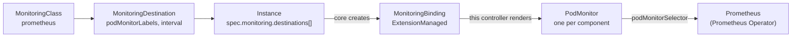

# monitoring-prometheus

> [!WARNING]
> **Pre-alpha.** OpenEverest v2 and its monitoring extensions are under active development.
> CRD schemas, chart values and defaults change frequently, including in breaking ways, and
> there is no supported upgrade path between versions yet. Not for production use.

[](https://github.com/openeverest/monitoring-prometheus/actions/workflows/ci.yaml)
[](https://github.com/openeverest/monitoring-prometheus/releases)
[](LICENSE)

Send the metrics of [OpenEverest](https://github.com/openeverest/openeverest) database
instances to a Prometheus run by the
[Prometheus Operator](https://github.com/prometheus-operator/prometheus-operator).

## What this is

A monitoring extension for OpenEverest. It installs the `prometheus` `MonitoringClass` and
the controller that fulfils it. The class is **ExtensionManaged**: the database provider only
exposes metrics endpoints, and this controller turns them into one `PodMonitor` per database
component, which the Prometheus you already run picks up through its `podMonitorSelector`.

> [!IMPORTANT]
> **This extension is not standalone.** It requires an OpenEverest installation (core CRDs and
> controller) and the Prometheus Operator with a `Prometheus` in the cluster. It does not
> install either of them.

## Compatibility

| monitoring-prometheus | OpenEverest | Prometheus Operator |
|---|---|---|
| `0.1.x` | `2.0.0-dev.5` | `v0.79` or later |

## How it fits



1. **Class.** The chart installs the cluster-scoped `prometheus` class
   (`controllerName: openeverest.io/monitoring-prometheus`) and the controller claims it
   (`Accepted=True`). The class requires metrics, so OpenEverest computes per provider whether
   each component serves metrics natively or needs an exporter sidecar:
   `kubectl get mclass prometheus -o yaml` shows it under `status.providers`.
2. **Destination.** A `MonitoringDestination` in the Instance's namespace references the class
   and says how the generated PodMonitors are labelled and how often they are scraped.
3. **Instance entry.** Listing the destination under `spec.monitoring.destinations[]` of an
   Instance sends that Instance's metrics there.
4. **Binding.** OpenEverest creates one `MonitoringBinding` per entry and accepts it. The
   provider then enables the exporters it needs (adding an exporter sidecar restarts the pods
   one at a time) and publishes the serving endpoints in `Instance.status.monitoring.sources`.
5. **PodMonitor per component.** For every Accepted binding of the class, the controller
   applies one `PodMonitor` per component, named `<binding>-<component>` (lower-cased), in the
   Instance's namespace and owned by the binding. A component that stops publishing metrics
   loses its PodMonitor. Removing the Instance entry deletes the binding, and Kubernetes
   garbage-collects its PodMonitors.

The controller writes only two things besides the PodMonitors: the binding's `Configured`
condition and the destination's `Ready` condition. It never writes Instances.

Every scrape endpoint carries, through `relabelings`, the identity labels
`openeverest_instance`, `openeverest_namespace`, `openeverest_provider` and `k8s_cluster_id`
(the UID of the `kube-system` namespace), plus `openeverest_component` and `openeverest_kind`.
Endpoints that probe several targets through a `target` query parameter also get the target
as their `instance` label, so each probed target is its own series.

Credentials are passed by reference only. An endpoint that needs authentication gets
`basicAuth` pointing at the `username` and `password` keys of the Secret the Instance publishes
for that credential profile, and a TLS CA becomes `tlsConfig.ca.secret`. The controller never
reads those Secrets; the Prometheus Operator resolves them when it builds the Prometheus
configuration.

## Prerequisites

- OpenEverest with the monitoring API (see [Compatibility](#compatibility)).
- The Prometheus Operator, or at least its `PodMonitor` CRD (`monitoring.coreos.com/v1`).
  Without it the controller still starts, and every binding reports `Configured=False` with
  reason `ApplyFailed` and retries every 30 seconds.
- A `Prometheus` that selects the generated PodMonitors in the Instances' namespaces.
- A database provider that publishes metrics endpoints (its `Provider` declares
  `spec.monitoring.componentTypes`).

## Installation

The chart is published as an OCI artifact to GitHub Container Registry:

```bash
helm install monitoring-prometheus \
  oci://ghcr.io/openeverest/charts/monitoring-prometheus \
  -n openeverest-system
```

Check that the class is claimed:

```bash
kubectl get monitoringclass prometheus
```

Upgrade and uninstall:

```bash
helm upgrade monitoring-prometheus \
  oci://ghcr.io/openeverest/charts/monitoring-prometheus -n openeverest-system
helm uninstall monitoring-prometheus -n openeverest-system
```

Uninstalling removes the class and the controller. Existing `PodMonitor`s stay until their
Instance entries are removed.

| Chart value | Default | Purpose |
|---|---|---|
| `class.create` | `true` | Install the `MonitoringClass` |
| `class.name` | `prometheus` | Name of the class; the controller renders only the bindings of this class |
| `class.displayName` | `Prometheus (Prometheus Operator)` | Name shown in the UI |
| `image.repository` | `ghcr.io/openeverest/monitoring-prometheus` | Controller image |
| `image.tag` | chart `appVersion` | Controller image tag |
| `leaderElection.enabled` | `true` | Required for `replicaCount` above 1 |
| `logLevel` | `info` | `debug`, `info` or `error` |

All values are in [values.yaml](charts/monitoring-prometheus/values.yaml).

## Usage

### 1. Point a Prometheus at the PodMonitors

Choose a label for the PodMonitors this extension creates and select it in your `Prometheus`.
Without `podMonitorNamespaceSelector` a Prometheus only selects `PodMonitor`s in its own
namespace; `{}` selects every namespace.

```yaml
apiVersion: monitoring.coreos.com/v1
kind: Prometheus
metadata:
  name: openeverest
  namespace: monitoring
spec:
  podMonitorNamespaceSelector: {}
  podMonitorSelector:
    matchLabels:
      release: kube-prometheus-stack
```

With [kube-prometheus-stack](https://github.com/prometheus-community/helm-charts/tree/main/charts/kube-prometheus-stack),
the bundled Prometheus already selects PodMonitors labelled `release: <helm release name>` in
every namespace; use that label below.

### 2. Create a destination

In the namespace of the Instances to monitor:

```yaml
apiVersion: monitoring.openeverest.io/v1alpha1
kind: MonitoringDestination
metadata:
  name: prometheus
spec:
  classRef:
    name: prometheus
  parameters:
    podMonitorLabels:
      release: kube-prometheus-stack
    interval: 30s
```

| Parameter | Type | Purpose |
|---|---|---|
| `podMonitorLabels` | map of strings | Labels put on every generated PodMonitor, so your Prometheus selects them |
| `interval` | Prometheus duration (`30s`, `1m`) | Scrape interval; empty uses the Prometheus default |

Neither parameter is required, but without `podMonitorLabels` most Prometheus setups select
none of the PodMonitors. The destination needs no credentials: Prometheus scrapes the pods
directly.

```bash
kubectl get mdest prometheus
```

`Ready=True` means the parameters are valid; the message shows the labels the PodMonitors get.

### 3. Send an Instance's metrics there

```yaml
apiVersion: core.openeverest.io/v1alpha1
kind: Instance
metadata:
  name: orders
spec:
  # ...
  monitoring:
    destinations:
      - name: prometheus
        destinationRef:
          name: prometheus
```

Then follow the binding and the PodMonitors it produces:

```bash
kubectl get mbind -l core.openeverest.io/instance=orders
kubectl get podmonitors -l core.openeverest.io/instance=orders
```

`Configured=True` lists the PodMonitors in its message. The metrics carry
`openeverest_instance="orders"` and `openeverest_namespace`, so a query such as
`up{openeverest_instance="orders"}` shows one series per scraped pod.

## Troubleshooting

`kubectl get mbind <name> -o yaml` shows the binding's `Configured` condition:

| Reason | Meaning |
|---|---|
| `Pending` | OpenEverest has not accepted the binding yet |
| `NotAccepted` | OpenEverest rejected the binding; the message carries its `Accepted` reason |
| `Retained` | The binding was accepted before and is not any more; the PodMonitors are kept as they are |
| `EndpointNotServing` | The Instance publishes no metrics endpoints yet (it is starting, or its exporters are being enabled) |
| `RenderFailed` | The Instance or destination is missing, the destination parameters are invalid, or a published endpoint cannot be rendered (for example it references a credential profile the Instance does not publish) |
| `ApplyFailed` | Writing a PodMonitor failed, usually because the `PodMonitor` CRD is not installed; retried every 30 seconds |
| `Configured` | The PodMonitors are in place |

If the binding is `Configured` but Prometheus shows no targets, check the Prometheus
`podMonitorSelector` and `podMonitorNamespaceSelector` against the PodMonitors' labels and
namespace, and the Prometheus Operator logs for rejected PodMonitors.

Controller logs:

```bash
kubectl logs -n openeverest-system deploy/monitoring-prometheus -f
```

## Development

Requires Go (see [go.mod](go.mod)), Docker, Helm, kubectl, and for the integration tests
[k3d](https://k3d.io) and [chainsaw](https://kyverno.github.io/chainsaw/).

| Command | Purpose |
|---|---|
| `make lint` | golangci-lint |
| `make test-unit` | Unit tests |
| `make build` | Controller binary in `bin/` |
| `make docker-build IMG=...` | Controller image |
| `make helm-lint` | Lint the chart |
| `make run` | Run the controller against the current kubeconfig |

The integration tests run the chart in a k3d cluster that holds only the OpenEverest and
Prometheus Operator CRDs; the test publishes an Instance's monitoring sources and accepts the
binding in place of the provider and OpenEverest:

```bash
make k3d-cluster-up
make docker-build load-image IMG=monitoring-prometheus:dev
make install-crds
make deploy-ci IMG=monitoring-prometheus:dev
make test-integration
make k3d-cluster-down
```

`make install-crds` installs the OpenEverest CRDs of the core version pinned in `go.mod`.

## Contributing

See the OpenEverest [contribution guide](https://github.com/openeverest/openeverest/blob/main/CONTRIBUTING.md).
Every commit needs a DCO sign-off (`git commit -s`).

## License

[Apache 2.0](LICENSE)
